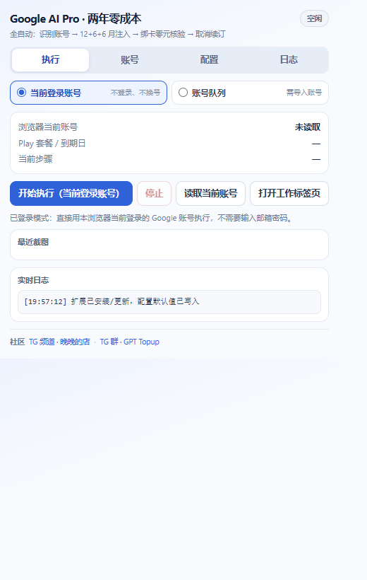

# Google AI Pro 2-Year Zero-Cost · Fully Automated Injector

> A Chrome / Edge extension (Manifest V3) that turns the whole "Google AI Pro 12 + 6 + 6 months free stacking"
> workflow into a single queue: detect account → inject offer tokens → zero-amount guarded checkout →
> cancel renewal → multi-source entitlement verification.
> **The default mode needs no email or password** — it uses the Google account already signed in to your browser.

[中文说明](README.md) · [Changelog](CHANGELOG.md)



---

## Table of contents

- [Features](#features)
- [Two run modes](#two-run-modes)
- [Installation](#installation)
- [Quick start](#quick-start)
- [Configuration](#configuration)
- [Pipeline](#pipeline)
- [Verification rules](#verification-rules)
- [Zero-cost guard](#zero-cost-guard)
- [How injection works](#how-injection-works)
- [Permissions & privacy](#permissions--privacy)
- [Project layout](#project-layout)
- [Development & tests](#development--tests)
- [Packaging](#packaging)
- [Troubleshooting](#troubleshooting)
- [FAQ](#faq)
- [Disclaimer](#disclaimer)

---

## Features

| Capability | Description |
| --- | --- |
| Fully automated pipeline | One 12-month layer + two 6-month layers + renewal cancellation, one click, stoppable and resumable |
| Dual mode | **Current signed-in account** (default, zero input) / **Account queue** (bulk accounts, auto login + 2FA) |
| Offer token injection | MAIN-world hooks on `f.req`(Ngbm) and `ear` to replace checkout items with 12m / 6m_ss / 6m tokens + YouTube free add-on |
| Inline card filling | Detects the card form inside the checkout modal, fills number / expiry / CVC / holder / tax-free ZIP 97201 |
| Zero-cost guard | Clicks **Subscribe** only when the amount due is provably 0 (or an explicit free trial); otherwise blocks and screenshots |
| Multi-source verification | Reads both Play and Google One, takes the later date, tolerates a 7-day billing drift and sync delay |
| Idempotent re-runs | Every layer reads the entitlement first; layers already satisfied are skipped |
| Crash recovery | Service-worker keep-alive + watchdog; the run resumes from the current step after a browser sleep |
| Logs & screenshots | Live log, per-step screenshots (optional permission), results written back to the account card |

---

## Two run modes

| Mode | Account input | Behaviour | Use when |
| --- | --- | --- | --- |
| **Current signed-in account** (default) | ❌ none | Detects the signed-in Google account → stacks three layers → cancels renewal → verifies. **Never types a password, never switches accounts** | Your daily browser, already signed in |
| **Account queue** | ✅ email + password + recovery email + TOTP | Logs in one by one (email → password → recovery → 2FA TOTP), then runs the full 5 steps | Bulk accounts, many accounts in a row |

> The signed-in mode never stores or uses a password. If Google asks for one during checkout,
> the extension stops and asks you to verify manually instead of guessing.

---

## Installation

### Option 1 — Load unpacked (recommended)

1. Clone / download this repository, e.g. `D:\tools\google-ai-pro-auto-ext`.
2. Open `chrome://extensions` (Edge: `edge://extensions`).
3. Enable **Developer mode** (top-right).
4. Click **Load unpacked** and pick the **repository root** (the folder that contains `manifest.json`),
   not its parent directory.
5. Pin the icon to the toolbar.

Requirements:

- Chrome / Edge **≥ 116** (MV3 `world: "MAIN"` content scripts and `scripting.executeScript({world:'MAIN'})`).
- No Node, Python, Playwright, local server or CDP port required.

> ⚠️ The folder must not contain any file or directory starting with `_` — Chrome reserves that prefix
> and refuses to load the extension. Both CI and the smoke test check this.

### Option 2 — Packaged `.zip` / `.crx`

- **zip**: unpack and load as described above.
- **crx**: Chromium browsers usually still require developer mode for off-store crx files; the zip is easier.
- Pack it yourself: `chrome.exe --pack-extension=<absolute path> --no-message-box`
  produces `<folder>.crx` and `<folder>.pem` next to it (**keep the private key private, never commit it**).

---

## Quick start

Using the default **signed-in account** mode:

1. Sign in to the target Google account (open `https://one.google.com/plans` once to confirm).
2. Click the toolbar icon → **Run** tab; make sure the mode is **Current signed-in account**.
3. Click **Read current account**. The log shows something like:
   ```
   🔎 已识别当前登录账号：you@gmail.com | 套餐: Google AI Pro (5 TB) | 权益截止: 2026-12-06（来源 Play）
   ```
   Double-check the email, especially with multiple accounts in the browser.
4. (Optional) Fill in a payment card on the **Config** tab; leave it empty if the account already has a payment method.
5. Click **Start (current account)**.
6. Leave the working tab alone. When it finishes, the account card shows
   `Completed` (entitlement reached) or `Pending sync` (order submitted, Google has not written it back yet —
   run again later and only the missing layers will be attempted).

---

## Configuration

### Config tab

| Field | Notes |
| --- | --- |
| Card number | Spaces are stripped automatically |
| Expiry month / year | Month 2 digits (`09`); year `2030` or `30` |
| CVC | 3–4 digit security code |
| Card holder | Optional, defaults to `CARD HOLDER` |
| Billing ZIP | Defaults to `97201` (Oregon, tax-free) |
| Auto login / 2FA | Used by queue mode; ignored in signed-in mode |
| Cancel renewal when done | Turning this off keeps auto-renewal (not recommended) |
| Zero-cost guard | On by default. Disabling it removes the amount check — special cases only |
| Strict mode | Accepts only an explicit "due today = 0.00" |
| Abort layer when verification fails | Off by default. When on, a layer must verify before continuing; otherwise it is marked *pending sync* and the queue continues |
| Grant screenshot permission | Optional `<all_urls>` request; without it you just get no screenshots |

> Card data lives only in local `chrome.storage.local`; nothing is uploaded. Clearing extension data removes it.

### Accounts tab (queue mode only)

One account per line, fields separated by `----` / `—` / `|` / `/` / Tab / `,` / spaces:

```
email----password----recovery-email----TOTP-secret
you@gmail.com----MyPassw0rd!----backup@gmail.com----JBSWY3DPEHPK3PXP
```

- Same email updates the existing entry instead of duplicating it.
- Only a full `password + TOTP secret` enables hands-free 2FA; without TOTP the run pauses for manual input.
- The TOTP secret is the base32 secret of your 2FA (16+ uppercase letters/digits, `=` optional).

### Storage keys (for debugging / backup)

| Key | Content |
| --- | --- |
| `gpro_accounts` | Account list (email, password, recovery, TOTP, status, expiry) |
| `gpro_card` | Payment card |
| `gpro_options` | Run mode and toggles |
| `gpro_inject` | Current offer config pushed to the injector |
| `gpro_state` | Run snapshot (progress, logs, last screenshot) |

Inspect everything from the service worker console
(`chrome://extensions` → this extension → *service worker* → Console):
`chrome.storage.local.get(null).then(console.log)`.

---

## Pipeline

```
Step 1  Account confirm   signed-in: probe current session; queue: email → password → recovery → TOTP
Step 2  Layer 1 · 12 mo   inject 12m token → click offer → zero-cost guard → subscribe → verify
Step 3  Layer 2 · +6 mo   inject 6m_ss (Samsung source) → same
Step 4  Layer 3 · +6 mo   inject 6m, fall back to 6m_2 → same
Step 5  Cancel renewal    manage → cancel → retention screen → reason → continue → confirm → final audit
```

Each layer reads the current entitlement first:

```
基准：今日 2026-11-06，现有最晚日期 2027-11-06（来源 Google One，约 12 个月）；本层目标 ≥ 2027-11-06
✅ 现有权益已达 12 个月，本层自动跳过
```

That is why **re-running or resuming is safe** — layers never stack twice.

---

## Verification rules

The part most implementations get wrong:

- **Two sources, later date wins**: reads
  `play.google.com/store/account/subscriptions` **and**
  `one.google.com/settings?expand=upgrade` + `one.google.com/plans`.
  For **monthly** subscribers, Play only shows the *next payment date* (next billing cycle, usually today +1 month),
  which is **not** the trial end; the real trial end / validity lives on the Google One side.
- **Target**: layer 1 ≥ today + 12 months, layer 2 ≥ today + 18, layer 3 ≥ today + 24; up to 7 days earlier is accepted
  (billing-cycle drift).
- **"Next monthly charge" can never pass as 12 months**: `2026-12-06` fails, `2027-11-06` passes.
- **Sync delay does not break the queue**: re-reads at 0 / 15 / 20 / 25 / 30 s (≈90 s total).
  If Google still has not written it back, the layer is marked **pending sync** and the queue continues.
  Re-run the same account minutes to hours later; only missing layers are attempted.
- **Final audit**: after step 5 the remaining months are computed; ≥24 = done, otherwise the log tells you what is missing.
- Need strict behaviour? Enable `Abort layer when verification fails`.

---

## Zero-cost guard

**Subscribe** is clicked only when the amount due is provably zero:

- **Standard mode** (default): parses the amount after labels such as "Today's total / Total due today / 今日应付"
  and requires every amount to be `0.00`. Without such a label it falls back to requiring
  `0.00` / `免费` / `免费试用` / `Free` / `won't be charged` and no "pay now / charged today" hints.
- **Strict mode**: only an explicit "due today = 0.00" is accepted; anything else is blocked.
- On a block the modal text is logged, a screenshot is taken, and **no payment button is clicked**.
- One order per checkout page lifetime — no duplicate submissions.

---

## How injection works

The injector runs in the **MAIN world** of `one.google.com`. Its config is pushed three ways:
`chrome.storage.local.gpro_inject` + `postMessage` + `chrome.scripting.executeScript({world:'MAIN'})`.

1. **XHR `f.req` rewrite**: hooks `XMLHttpRequest.prototype.send`, parses the `Ngbm` call payload and replaces
   `node[12]` (line items) with `[AI item key + 12m/6m token, YouTube free add-on token]`;
   also rewrites `node[10]` / `node[2][2][8]`, sets renewal mode 5 in `node[7]` and attaches the existing
   subscription id so the offer **stacks**.
2. **`ear` rewrite**: hooks `TrustedTypePolicy.prototype.createScriptURL`, the
   `HTMLIFrameElement.prototype.src` setter and `Element.prototype.setAttribute` to inject
   `ear[13][0] = full_items`, patch the base64 inner `ear[4][0][8]`, and set `ear[24] = null` (drops the original price).
3. **Subscription id**: scraped from the page's static data (24-char `"xxxx.AO-..."` / `AF_initDataCallback` blocks);
   if unavailable, the injector inherits it dynamically from `ear[8][5]` / `node[7][5]`.

Item keys and tokens live in [`core.js`](core.js) (`TOKENS`: `12m` / `6m_ss` / `6m` / `6m_2` / `yt`).

---

## Permissions & privacy

| Permission | Purpose |
| --- | --- |
| `storage` | Local account list, card, options, run snapshot |
| `scripting` | Push the offer config into the `one.google.com` MAIN world |
| `tabs` | Create / focus the working tab, read page state |
| `alarms` | 1-minute watchdog to resume after the service worker sleeps |
| `host_permissions` (one / play / tokenized.play / pay / payments / accounts / gds) | Content scripts and page automation |
| `optional_host_permissions: <all_urls>` | **Only** for screenshots (`tabs.captureVisibleTab`), requested on demand |

- Everything stays in local `chrome.storage.local`; there is no telemetry or network reporting code.
- Signed-in mode never uses or stores your password; queue mode uses it locally to fill the login form.
- Tip: clear your card from the Config tab (or wipe extension storage) after you are done.

---

## Project layout

```
google-ai-pro-auto-ext/
├── manifest.json          MV3 manifest: permissions / content scripts / MAIN-world injection
├── core.js                Shared core: tokens, layers, date math, zero-amount proof, TOTP, DOM helpers
├── background.js          Orchestrator: queue, login, layers, checkout polling, cancel, watchdog, RPC
├── inject.js              MAIN-world request rewriter for one.google.com
├── popup.html/.css/.js    Control panel (Run / Accounts / Config / Logs)
├── content/
│   ├── bridge.js          Config push, offer-button click, subscription-id / date / email probing
│   ├── login.js           accounts.google.com login agent (single-step ticks, interruptible)
│   ├── checkout.js        Checkout frame: card fill, zero-cost guard, subscribe, re-auth
│   └── play.js            play.google.com: subscription read, resubscribe, cancel state machine
├── icons/                 16 / 48 / 128 icons
├── docs/screenshots/      UI screenshots
├── tests/
│   ├── core.test.cjs      Unit tests (node --test)
│   └── test_smoke.py      End-to-end smoke test loading the extension in real Chromium (Playwright)
├── .github/workflows/     CI: unit tests + syntax + reserved-name + manifest checks
├── CHANGELOG.md
├── LICENSE
└── package.json
```

**Messaging model**: every cross-frame action is a broadcast from `background.js` and an event back from whichever
content script understands it. No frame-id enumeration is required, so a `pay.google.com` card iframe nested inside
`tokenized.play.google.com` is still reached.

---

## Development & tests

```bash
# Unit tests: token config / date math / zero-amount proof / TOTP / target check
npm test            # same as: node --test tests/core.test.cjs

# Syntax check
npm run lint

# End-to-end smoke test: real Chromium loads the extension, Google domains are intercepted by local fixtures
pip install playwright && python -m playwright install chromium
python tests/test_smoke.py
```

The smoke test covers: extension load + manifest, popup rendering + RPC, account import / card save,
`Ngbm f.req` rewrite (tokens really end up in the request body), `ear` injection with `ear[24]` cleared,
zero-cost verification before clicking subscribe, non-zero amounts being blocked,
signed-in mode account detection / start / stop, and the later-date-wins multi-source rule.

Debugging cheat sheet:

- Background logs: `chrome://extensions` → extension → *service worker* → Console.
- Page-side state: the injector shows `注入已挂载 · layer1 · 已改写 N` at the bottom-right of `one.google.com`.
- Content-script logs: DevTools → Sources → Content scripts.

---

## Packaging

```powershell
# Runtime files only (no tests/docs/.github)
$tmp = Join-Path $env:TEMP "gpro-pack"
New-Item -ItemType Directory -Force -Path $tmp | Out-Null
Copy-Item manifest.json,core.js,background.js,inject.js,popup.html,popup.css,popup.js,LICENSE -Destination $tmp
Copy-Item -Recurse content,icons -Destination $tmp
Compress-Archive -Path (Join-Path $tmp "*") -DestinationPath google-ai-pro-auto-ext.zip -Force
```

Release checklist:

1. `version` in `manifest.json` bumped (SemVer).
2. `npm test` and `python tests/test_smoke.py` green.
3. No `_`-prefixed files or directories (Chrome reserved name).
4. Never commit `*.pem`, `.crx`, or personal account / card data.

---

## Troubleshooting

| Symptom | Cause / fix |
| --- | --- |
| `Cannot load extension with file or directory name _xxx` | A `_`-prefixed entry exists; Chrome reserves that prefix — rename or move it out |
| `Manifest file is missing or unreadable` | Wrong folder level; pick the one containing `manifest.json` |
| "Browser is not signed in to Google" | Sign in on that tab first, or use *Open working tab* to log in manually and retry |
| "Checkout requires your Google password" | Signed-in mode intentionally stores no password: verify manually once, or use queue mode |
| "No available payment method and no card configured" | Add a card on the Config tab, or bind one to that Google account first |
| "No clickable offer button found" | The plans page copy changed, or this account does not see that offer; check `one.google.com/plans` and extend `T.OFFER` in `core.js` |
| "Checkout modal not detected" | Injection did not take effect: confirm the tab is `one.google.com` and the bottom-right badge says 注入已挂载 |
| "Zero-cost check failed, submission blocked" | The modal shows a real price — expected block; re-check the copy or enable strict mode |
| "Verifying… target not reached" then continues | Normal: the order is submitted, Google has not written it back; marked *pending sync*, re-run later |
| Play keeps showing "today + 1 month" | Normal for monthly subscribers; check Google One's *valid until / trial ends*. The extension takes the later date |
| Screenshot area stays empty | Click *Grant screenshot permission* on the Config tab; without it only screenshots are affected |
| Queue stopped halfway | Keep-alive + watchdog resume automatically; you can also click Start again (idempotent) |
| Wrong account got touched | Queue mode aborts when the signed-in account differs from the target; sign in to the right account first |

---

## FAQ

**Why is no password needed?**
The default mode reuses the browser session and only reads the signed-in email; it never touches passwords.

**Can it charge me twice?**
Zero-cost guard + one submission per checkout page + idempotent layer skipping. A non-zero or unreadable amount blocks the click.

**Why did the Play date not change?**
For monthly subscribers the Play "next payment date" is just the next billing cycle. The trial end is on the
Google One side; the extension already takes the later of both.

**Multiple accounts?**
Switch to **Account queue**, import `email----password----recovery----TOTP`, and they run one after another.

**Does it upload my data?**
No. Everything is local in `chrome.storage.local`; there is no reporting code.

**Firefox / Safari?**
Not supported — it relies on Chromium's MV3 `world: "MAIN"` and `scripting.executeScript`.

---

## Community

- Channel: <https://t.me/wanwandeshop> — releases and update notes
- Group: <https://t.me/gpt_topup> — usage questions and experience sharing

Updates related to this project are posted to the channel first; errors, environment differences and
failure causes are discussed in the group.

---

## Disclaimer

This is a personal automation tool: every click, card binding, subscription and cancellation is initiated by you
on your own Google account. Prices, eligibility, stackability and expiry dates are whatever Google shows.

This project is not affiliated with, endorsed by, or authorized by Google. Verify your regional terms before use;
account risk-control actions, billing disputes or any other consequence of using this tool are your own responsibility.
If you are unsure about the risks, do not use it.

License: [MIT](LICENSE)
