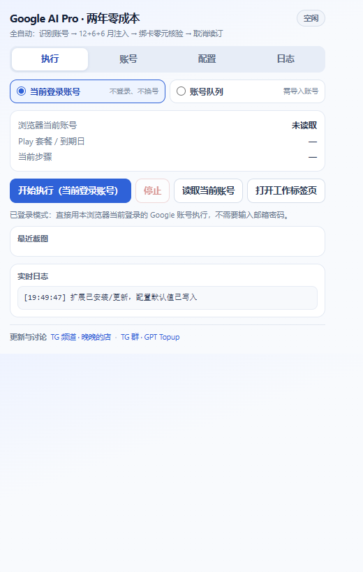

# Google AI Pro 两年零成本 · 全自动注入器

> Chrome / Edge 扩展（Manifest V3），把「Google AI Pro 12 + 6 + 6 个月零元叠加」整条链路做成一条队列：
> 识别账号 → 注入 offer 令牌 → 零元核验结账 → 取消续订 → 多来源核验权益。
> **默认模式不需要输入账号密码**：直接用浏览器当前已登录的 Google 账号。

[English README](README.en.md) · [更新日志](CHANGELOG.md)

> 📣 更新与讨论都在 TG：频道 [晚晚的店](https://t.me/wanwandeshop) · 群 [GPT Topup](https://t.me/gpt_topup)
> —— 这两个号是专门研究 Google AI / ChatGPT 订阅、零元叠加、账号与支付环境的，令牌更新和踩坑记录都在里面。



---

## 目录

- [功能一览](#功能一览)
- [交流与更新](#交流与更新)
- [两种运行模式](#两种运行模式)
- [安装](#安装)
- [快速开始](#快速开始)
- [配置详解](#配置详解)
- [执行流程](#执行流程)
- [权益核验规则](#权益核验规则)
- [零元保护](#零元保护)
- [注入原理](#注入原理)
- [权限与隐私](#权限与隐私)
- [项目结构](#项目结构)
- [开发与测试](#开发与测试)
- [打包与分发](#打包与分发)
- [故障排查](#故障排查)
- [常见问题](#常见问题)
- [免责声明](#免责声明)

---

## 功能一览

| 能力 | 说明 |
| --- | --- |
| 全自动流水线 | 一层 12 个月 + 两层各 6 个月 + 取消续订，一键跑完，中途可停可续 |
| 双模式 | **当前登录账号**（默认，零输入）/ **账号队列**（批量放号，自动登录 + 2FA） |
| offer 令牌注入 | 主世界劫持 `f.req`(Ngbm) 与 `ear`，把结账内容改成 12m / 6m_ss / 6m 令牌 + YouTube 免费包 |
| 内联绑卡 | 结账弹窗里识别卡表单，自动填卡号 / 有效期 / CVC / 持卡人 / 免税邮编 97201 |
| 零元保护 | 只有当次应付确认为 0（或明确免费试用）才点【订阅】，否则拦截并截图 |
| 多来源核验 | 同时读 Play 与 Google One，取较晚日期，容忍 7 天账期误差与同步延迟 |
| 幂等可重跑 | 每层先读数再决定，已达成的层自动跳过；同步慢的层标记「待同步」后可补齐 |
| 断点续跑 | service worker 保活 + 看门狗，被浏览器休眠后自动从当前步骤恢复 |
| 日志与截图 | 控制台实时日志、步骤截图（截图权限可选）、执行结果写回账号卡片 |

---

## 交流与更新

> 令牌什么时候换、账号环境怎么养、Google 和 Play 的风控怎么绕——这些没人能一个人闷头啃下来。
> 我们的 TG 频道和群就是专门研究这些的，更新和踩坑记录都第一时间扔在里面。

| | 入口 | 里面有什么 |
| --- | --- | --- |
| 📣 **TG 频道 · 晚晚的店** | <https://t.me/wanwandeshop> | 版本发布、令牌 / 优惠更新、Google 与 Play 政策变动、批量实测战报 |
| 💬 **TG 群 · GPT Topup** | <https://t.me/gpt_topup> | 专攻 Google AI / ChatGPT 订阅与充值、零元叠加、账号与支付环境；报错、卡单、失败原因在这里一起对 |

**频道看更新，群里聊实操。**

建议顺序：装好扩展 → 进群看当前有效玩法与已知坑 → 再点执行。
很多"失败"其实是当天的令牌或风控状态变了，群里一般已经有人试过并给了替代方案。

---

## 两种运行模式

| 模式 | 需要填账号吗 | 行为 | 适用场景 |
| --- | --- | --- | --- |
| **当前登录账号**（默认） | ❌ 不需要 | 探测浏览器当前登录的 Google 账号 → 三层叠加 → 取消续订 → 核验。**不输密码、不切换账号** | 平时就用这个浏览器、账号已登录 |
| **账号队列** | ✅ 邮箱 + 密码 + 辅助邮箱 + TOTP | 逐个自动登录（邮箱 → 密码 → 辅助邮箱 → 2FA 动态码）后跑完整 5 步 | 批量放号、多账号排队 |

> 已登录模式全程不保存、不使用密码；遇到 Google 要求输入密码会直接提示你手动验证，而不是猜。

---

## 安装

### 方式一：加载已解压扩展（推荐，便于更新）

1. 下载 / 克隆本仓库到本地，例如 `D:\tools\google-ai-pro-auto-ext`。
2. Chrome 打开 `chrome://extensions`（Edge 打开 `edge://extensions`）。
3. 右上角开启 **开发者模式**。
4. 点 **加载已解压的扩展程序**，选择**仓库根目录**（含 `manifest.json` 的那一层），不要选外层父目录。
5. 把图标固定到工具栏。

环境要求：

- Chrome / Edge **≥ 116**（需要 MV3 的 `world: "MAIN"` 内容脚本与 `scripting.executeScript({world:'MAIN'})`）。
- 无需 Node、Python、Playwright、本地服务器、CDP 端口。

> ⚠️ 目录内**不能出现以 `_` 开头的文件或目录**（Chrome 保留名，会直接拒绝加载）。
> 仓库的 CI 与冒烟测试都会检查这一条。

### 方式二：安装打包好的 `.crx` / `.zip`

- **zip**：解压后按方式一加载解压目录。
- **crx**：Chromium 系浏览器对非商店 crx 会拦截，通常仍需开发者模式；推荐直接用 zip。
- 自行打包：`chrome.exe --pack-extension=<仓库绝对路径> --no-message-box`，
  会在父目录生成 `<目录名>.crx` 与 `<目录名>.pem`（私钥务必保存好，**不要提交**）。

---

## 快速开始

以默认的**已登录账号模式**为例：

1. 在浏览器里登录目标 Google 账号（要能打开 `https://one.google.com/plans`）。
2. 点击工具栏图标 → 「执行」页签，确认顶部模式是 **当前登录账号**。
3. 点 **读取当前账号**，日志会出现：
   ```
   🔎 已识别当前登录账号：you@gmail.com | 套餐: Google AI Pro (5 TB) | 权益截止: 2026-12-06（来源 Play）
   ```
   确认邮箱没认错（多账号时尤其重要）。
4. （可选）「配置」页签填支付卡；账号里已有可用付款方式时可留空。
5. 点 **开始执行（当前登录账号）**。
6. 让那个工作标签页自己跑，别手动点。结束后看「执行」页签的账号卡片：
   `已完成` = 权益已达标；`待同步` = 订单已提交但 Google 还没回写，稍后重跑即可补齐。

成功一次之后，同样的操作会**自动跳过**已达成的层，只补剩下的。

---

## 配置详解

### 「配置」页签

| 字段 | 说明 |
| --- | --- |
| 卡号 | 完整卡号，空格会被自动去掉 |
| 有效期月 / 年 | 月 2 位（`09`），年可写 `2030` 或 `30` |
| CVC | 3~4 位安全码 |
| 持卡人 | 可留空，默认 `CARD HOLDER` |
| 账单邮编 | 默认 `97201`（美国俄勒冈州，免税） |
| 自动登录 / 2FA | 队列模式用；已登录模式忽略 |
| 完成后自动取消续订 | 关掉则保留自动续订（不建议） |
| 结账零元保护 | 默认开。关掉后不再校验金额，只在特殊场景用 |
| 严格模式 | 只认「今日应付 = 0.00」这种明确文案，适合首次观察弹窗 |
| 核验不到对应月份就中止本层 | 默认关。开着就是"必须核验通过才继续"，否则标记待同步并继续 |
| 授予截图权限 | 可选，申请 `<all_urls>`；不授权只是没有截图 |

> 卡信息只写入本机 `chrome.storage.local`，不上传任何服务器；清理扩展数据即彻底删除。

### 「账号」页签（仅队列模式）

每行一个账号，字段用 `----` / `—` / `|` / `/` / Tab / `,` / 空格分隔：

```
邮箱----密码----辅助邮箱----TOTP密钥
you@gmail.com----MyPassw0rd!----backup@gmail.com----JBSWY3DPEHPK3PXP
```

- 邮箱相同则更新（不会重复创建）。
- 只有 `密码 + TOTP 密钥` 齐全才能全自动过 2FA；缺 TOTP 时会在需要验证码时提示人工介入。
- TOTP 密钥是 2FA 的 base32 secret（16 位以上大写字母数字，`=` 可省略）。

### 存储键（便于排查 / 备份）

| key | 内容 |
| --- | --- |
| `gpro_accounts` | 账号列表（邮箱、密码、辅助邮箱、TOTP、状态、到期日） |
| `gpro_card` | 支付卡 |
| `gpro_options` | 运行模式与各项开关 |
| `gpro_inject` | 当前下发给注入器的 offer 配置 |
| `gpro_state` | 运行快照（进度、日志、最近截图） |

在 `chrome://extensions` → 本扩展 → 「检查视图 service worker」→ Console 里可执行
`chrome.storage.local.get(null).then(console.log)` 查看全部。

---

## 执行流程

```
Step 1  账号确认        已登录模式：探测当前会话；队列模式：邮箱→密码→辅助邮箱→TOTP
Step 2  首层 12 个月    注入 12m 令牌 → 点方案页优惠入口 → 零元核验 → 订阅 → 核验
Step 3  二层 +6 个月    注入 6m_ss（Samsung 来源）→ 同上
Step 4  三层 +6 个月    注入 6m，失败自动换备用 6m_2 → 同上
Step 5  取消续订        管理 → 取消订阅 → 挽留页 → 原因 → 继续 → 确认 → 最终对账
```

每一层开跑前都会先读权益：

```
基准：今日 2026-11-06，现有最晚日期 2027-11-06（来源 Google One，约 12 个月）；本层目标 ≥ 2027-11-06
✅ 现有权益已达 12 个月，本层自动跳过
```

因此**重复点执行、中断后重跑都是安全的**，不会重复叠层。

---

## 权益核验规则

这是最容易误判的地方：

- **两路来源取较晚者**：同时读
  `play.google.com/store/account/subscriptions` 与
  `one.google.com/settings?expand=upgrade` + `one.google.com/plans`。
  Play 对**月付账号**只显示「下次付款日期」（下一个账期，通常今天 +1 个月），
  **那不是**试用到期日；真正的试用结束 / 有效期在 Google One 侧。
- **目标口径**：首层 ≥ 今天+12 个月，二层 ≥ 今天+18，三层 ≥ 今天+24，允许早 7 天（账期误差）。
- **不会被"月付下一期"骗过**：`2026-12-06` 不会被判成 12 个月；`2027-11-06` 才会。
- **同步延迟不中断**：提交后按 0/15/20/25/30 秒回读（约 90 秒）；仍无更新 →
  标记 **「待同步」** 并继续下一层。几分钟到几小时后重跑同一账号即可补齐。
- **最终对账**：Step 5 后换算剩余月数，≥24 判完成，不足则提示还缺多少。
- 想要"必须核验通过才继续"：勾选 `核验不到对应月份就中止本层`。

---

## 零元保护

结账弹窗里只有在**确认当次应付为 0** 后才会点【订阅】：

- **标准模式**（默认）：优先解析「今日应付 / Total due today」等标签后的美元金额，必须全为 `0.00`；
  没有该标签时退化为要求出现 `0.00` / `免费` / `免费试用` / `Free` / `won't be charged`，且不出现「立即付款 / charged today」。
- **严格模式**：只认明确的「当次应付 = 0.00」，识别不到直接拦。
- 拦截时记录弹窗原文、截图、**不点任何付款按钮**。
- 每个结账页面生命周期只提交一次订单，杜绝重复下单。

---

## 注入原理

注入器跑在 `one.google.com` 的**主世界**（MAIN world），配置由后台三路下发：
`chrome.storage.local.gpro_inject` + `postMessage` + `chrome.scripting.executeScript({world:'MAIN'})`。

1. **XHR `f.req` 改写**：钩住 `XMLHttpRequest.prototype.send`，解析 `f.req` 里的 `Ngbm` 调用负载，
   把 `node[12]`（付款行项目）换成
   `[AI 商品键 + 12m/6m 令牌, YouTube 免费附加包令牌]`；
   同步替换 `node[10]` / `node[2][2][8]`；`node[7]` 写入续订模式 5 并挂上原订阅 ID 实现**叠加**。
2. **`ear` 参数改写**：钩住 `TrustedTypePolicy.prototype.createScriptURL`、
   `HTMLIFrameElement.prototype.src` setter、`Element.prototype.setAttribute`，
   对 `/eacquire/multiline?ear=...` 注入 `ear[13][0] = full_items`、
   解 base64 的内层 `ear[4][0][8]`，并把 `ear[24]` 置 `null`（清掉原价）。
3. **订阅 ID**：优先从页面静态数据抓 24 位订阅 ID（`"xxxx.AO-..."` / `AF_initDataCallback` 块），
   抓不到则由拦截器从 `ear[8][5]` / `node[7][5]` 动态继承。

商品键与令牌：

```
subs:com.google.android.apps.subscriptions.red:g1.2tb.ai.subs_variant
subs:com.google.android.apps.subscriptions.red:g1.youtube_premium_individual_add_on
```

令牌常量见 [`core.js`](core.js) 的 `TOKENS`（`12m` / `6m_ss` / `6m` / `6m_2` / `yt`）。

---

## 权限与隐私

| 权限 | 用途 |
| --- | --- |
| `storage` | 本机保存账号、卡信息、配置、运行快照 |
| `scripting` | 向 `one.google.com` 主世界注入 offer 配置 |
| `tabs` | 创建/切换工作标签页、读取页面状态 |
| `alarms` | 1 分钟看门狗，service worker 被休眠后恢复执行 |
| `host_permissions`（one / play / tokenized.play / pay / payments / accounts / gds） | 内容脚本与页面自动化 |
| `optional_host_permissions: <all_urls>` | **仅**为截图能力（`tabs.captureVisibleTab`）按需申请，可拒绝 |

- 全部数据仅存本机 `chrome.storage.local`，扩展没有任何联网上报代码。
- 已登录模式不使用、不保存密码；队列模式的密码只在本机用于自动登录表单。
- 建议：跑完把自己的卡信息从「配置」里清掉，或直接删除扩展数据。

---

## 项目结构

```
google-ai-pro-auto-ext/
├── manifest.json          MV3 清单：权限 / 内容脚本 / 主世界注入
├── core.js                共享底座：令牌、层级、日期数学、零元核验、TOTP、DOM 工具
├── background.js          流水线调度器：队列、登录、三层叠加、结账轮询、取消续订、看门狗、RPC
├── inject.js              one.google.com 主世界请求改写器
├── popup.html/.css/.js    控制台（执行 / 账号 / 配置 / 日志）
├── content/
│   ├── bridge.js          配置下发、优惠按钮点击、订阅 ID / 日期 / 邮箱探测
│   ├── login.js           accounts.google.com 登录代理（单步 tick，可中断）
│   ├── checkout.js        结账子框架：绑卡、零元核验、点订阅、二次验证
│   └── play.js            play.google.com：订阅读取、重新订阅、取消续订状态机
├── icons/                 16 / 48 / 128 图标
├── docs/screenshots/      UI 截图
├── tests/
│   ├── core.test.cjs      纯函数单测（node --test）
│   └── test_smoke.py      真实 Chromium 加载扩展的端到端冒烟测试（Playwright）
├── .github/workflows/     CI：单测 + 语法 + 保留名 + manifest 校验
├── CHANGELOG.md
├── LICENSE
└── package.json
```

**通信模型**：所有跨框架操作由 `background.js` 广播指令、内容脚本回报事件完成，
不依赖 frameId 枚举，因此 `tokenized.play.google.com` 里再嵌 `pay.google.com` 绑卡框架也不会迷路。

---

## 开发与测试

```bash
# 纯函数单测：令牌配置 / 日期数学 / 零元核验 / TOTP / 目标判定
npm test            # 等价于 node --test tests/core.test.cjs

# 语法检查
npm run lint

# 端到端冒烟：真实 Chromium 加载扩展，把 Google 域名拦截成本地夹具
pip install playwright && python -m playwright install chromium
python tests/test_smoke.py
```

冒烟测试覆盖：扩展加载与 manifest、popup 渲染与 RPC、账号导入 / 卡保存、
`Ngbm f.req` 改写（令牌真的进请求体）、`ear` 注入与 `ear[24]` 清空、
结账零元核验后点【订阅】、非零金额被拦截、已登录模式识别账号与启停、
多来源核验取较晚日期。

调试小抄：

- 扩展后台日志：`chrome://extensions` → 本扩展 → 「检查视图 service worker」→ Console。
- 页面侧状态：注入器在 `one.google.com` 右下角显示 `注入已挂载 · layer1 · 已改写 N`。
- 内容脚本日志：DevTools → Sources → Content scripts。

---

## 打包与分发

```powershell
# 只打运行时文件（不含 tests/docs/.github）
$tmp = Join-Path $env:TEMP "gpro-pack"
New-Item -ItemType Directory -Force -Path $tmp | Out-Null
Copy-Item manifest.json,core.js,background.js,inject.js,popup.html,popup.css,popup.js,LICENSE -Destination $tmp
Copy-Item -Recurse content,icons -Destination $tmp
Compress-Archive -Path (Join-Path $tmp "*") -DestinationPath google-ai-pro-auto-ext.zip -Force
```

发布前检查清单：

1. `manifest.json` 的 `version` 已递增（SemVer）。
2. `npm test` 与 `python tests/test_smoke.py` 全绿。
3. 目录里没有 `_` 前缀文件/目录（Chrome 保留名）。
4. 不要把 `*.pem`、`.crx`、个人账号/卡信息提交进仓库。

---

## 故障排查

| 现象 | 原因 / 处理 |
| --- | --- |
| 加载扩展报 `Cannot load extension with file or directory name _xxx` | 目录里有 `_` 前缀条目，Chrome 保留名；改名或移出扩展目录 |
| `Manifest file is missing or unreadable` | 选错目录层级，要选中含 `manifest.json` 的那层 |
| 已登录模式提示「浏览器当前未登录 Google 账号」 | 先在该标签页登录 Google；或用「打开工作标签页」手动登录后重试 |
| 已登录模式提示「结账要求输入 Google 账号密码二次验证」 | 该模式故意不存密码：手动验证一次，或改用账号队列模式 |
| 提示「该账号没有可用付款方式，且未填写支付卡」 | 到「配置」填卡，或先在这个 Google 账号绑卡一次 |
| 「未找到可点击的优惠入口按钮」 | 方案页文案变了或该账号不展示该优惠；看 `one.google.com/plans` 按钮文字，改 `core.js` 的 `T.OFFER` |
| 「尚未检测到结账弹窗」 | 注入没生效：确认标签页是 `one.google.com`，右下角应显示「注入已挂载」 |
| 「零元核验未通过，已阻止提交」 | 弹窗显示的是正价，属正常拦截；核对文案，必要时改勾严格模式再跑 |
| 「核验中…尚未达到 12 个月」然后继续 | 正常：订单已提交、Google 未回写；标记「待同步」，稍后重跑补齐 |
| Play 一直显示「今天 +1 个月」 | 月付账号的正常表现，看 Google One 的「有效期至 / 试用结束」；扩展已按较晚者判断 |
| 截图区一直空 | 到「配置」点「授予截图权限」；不授权只影响截图 |
| 队列跑到一半停了 | 有保活 + 看门狗会自动续跑；也可手动再点执行（幂等） |
| 多账号串号 | 队列模式遇到登录后账号与目标不一致会主动中止；先切对账号再跑 |

---

## 常见问题

**Q：为什么不需要账号密码？**
A：默认模式直接复用浏览器登录态，扩展只读当前会话里的账号邮箱，不碰密码。

**Q：会重复扣费吗？**
A：零元保护 + 每页面只提交一次订单 + 层幂等跳过，三重防护；金额非 0 或读不明确会拦截。

**Q：为什么 Play 的日期没变？**
A：月付账号的「下次付款日期」只是下个账期，不等于试用到期日；请以 Google One 侧为准，扩展已两侧取较晚。

**Q：能跑多个账号吗？**
A：可以，切到「账号队列」模式，导入 `邮箱----密码----辅助邮箱----TOTP`，按顺序自动登录执行。

**Q：会不会上传我的数据？**
A：没有。所有数据只在本机 `chrome.storage.local`，代码中无任何上报逻辑。

**Q：支持 Firefox / Safari 吗？**
A：不支持。依赖 Chromium 的 MV3 `world: "MAIN"` 与 `scripting.executeScript`。

---

## 找到我们

| | 入口 | 定位 |
| --- | --- | --- |
| 📣 TG 频道 | <https://t.me/wanwandeshop> | 更新优先发这里：版本、令牌、政策变动、实测结论 |
| 💬 TG 群 | <https://t.me/gpt_topup> | 专门研究 Google AI / ChatGPT 订阅、充值、零元叠加、账号与支付环境；提问、报错、对方案 |

两个号都只专注这一条线，不灌水。用之前先扫一眼群里的置顶，通常写着"现在还能用的姿势"和"最近别碰的坑"。

---

## 免责声明

本项目是自用自动化工具：所有点击、绑卡、订阅、取消都由你在自己的 Google 账号上发起，
金额、资格、是否可叠加、到期日一律以 Google 页面显示为准。

本项目与 Google 无任何关联，未获其授权或认可。使用前请自行确认所在地区与服务条款；
因使用本工具产生的账号风控、订阅纠纷或其他后果由使用者自负。
若你不确定风险，请不要使用。

许可证：[MIT](LICENSE)
